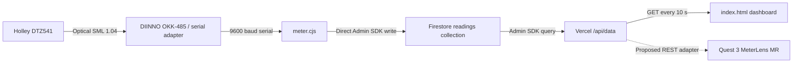

# MeterLens MR - Living Project Context

> Read this file at the start of every MeterLens MR session. Update the current-state sections and append a session log entry before ending the session.

## Document status

- Last updated: 2026-07-15 (Europe/Berlin)
- Repository: `https://github.com/harjeetks3/smart-meter`
- Local branch at audit: `main`
- Audited commit: `59d830bd6c6cacd11dd2f52c242647ea3f085655`
- `origin/main` and `upstream/main` matched the audited commit.
- Pre-existing local change: `index.html` was modified before this file was created. Preserve it unless the user explicitly asks to change or discard it.
- Local Phase 0, Phase 1, and Phase 2 implementations are complete but not committed or deployed. Phase 2 passed a real SA0013 capture, one-document Firestore write, and live/capabilities API verification. The exposed key still needs owner-side revocation and coordinated Git-history cleanup.
- Unity project status: not created yet.
- Project name: **MeterLens MR**

## Source-of-truth order

When facts conflict, use this order:

1. Current repository code and a captured response from the deployed API.
2. Behavior verified on the deployed dashboard.
3. The supplied Holley and DIINNO manuals.
4. Design proposals in this document.

Do not describe a meter capability as an available app feature unless the parser, stored record, and API expose it.

## Project objective and demo statement

The university project is **Smartify a Digital Meter for Energy Transparency**. It targets German households with moderate annual electricity consumption below 6000 kWh that often have a modern digital meter without a full Smart Meter Gateway.

MeterLens MR is a Meta Quest 3 passthrough experience. The user looks at the real Holley DTZ541 meter, manually anchors a spatial dashboard beside it, and sees live power, cumulative energy totals, trends, phase data when available, and technical OBIS data. The experience should make the meter feel like the physical source of the data, rather than presenting a web page in a floating browser.

Demo statement:

> German digital meters are not always smart for normal users below 6000 kWh/year. Our system reads the meter locally and visualises consumption. The web dashboard gives normal access, while the Quest 3 MR layer anchors the data directly onto the physical meter, making invisible energy usage visible in the real world.

## Supplied reference documents

The following local PDFs were reviewed through text extraction and rendered-page inspection:

- `C:\Users\harje\Downloads\AI stuff\Metering_EGR.pdf`
  - Page 1: project brief, below-6000-kWh target, and optical/RS485/LoRaWAN scope.
- `C:\Users\harje\Downloads\AI stuff\3e6f85.pdf`
  - Holley DTZ541 LoRaWAN + LoRa user manual, 36 PDF pages.
  - PDF page 8: DTZ541 variants; MSB interface can be RS485 or RS232 depending on the exact meter type.
  - PDF page 11: three-phase technical data and billing register families.
  - PDF page 18: billing registers `1.8.0`, `1.8.1`, `1.8.2`, `2.8.0`, `2.8.1`, `2.8.2`.
  - PDF pages 19-20: INFO and MSB datasets and serial settings.
  - PDF pages 31-33: LoRaWAN record layouts, scaling, per-phase power, and status data.
- `C:\Users\harje\Downloads\AI stuff\DIINNO-OKK-485.pdf`
  - Page 1: electrical/optical rates, half-duplex mode, power requirements, dimensions, and 6P6C pinout.
  - Page 2: example connection chains for basis meter and mME-EHZ variants.

### Verified hardware/protocol facts

- Meter: Holley DTZ541 three-phase electricity meter.
- Current optical head: Bayha Electronics `SA0013_UsbSensor`, directly connected
  by USB and exposed by Windows as a virtual COM port. The local machine sees
  it as `COM5` (`VID_1A86`, `PID_7523`). The earlier DIINNO/RS485 chain is not
  the current test setup.
- Protocol: SML 1.04.
- Front INFO optical interface: 9600 baud, 8-N-1, PUSH mode, one record per second.
- INFO datasets:
  - Reduced: identity and billing registers, with reduced precision.
  - Complete: billing registers plus signed total active power.
  - Manufacturer-specific: adds per-phase power, voltage, current, phase angles, frequency, historical values, firmware, checksum, and error register.
- Rear MSB interface: terminals 27/28, 9600 baud, 8-N-1, RS485, SML 1.04, PUSH mode, manufacturer-specific record every second. Confirm the exact DTZ541 variant because the manual also lists RS232 as another variant.
- LoRaWAN record 2 contains totals `1.8.0` through `2.8.2`, `Psum`, `PL1`, `PL2`, `PL3`, a status word, and a second index. Energy values use 0.1 Wh units and power values use 0.1 W units in that binary payload.
- DIINNO OKK-485:
  - Supply: +5 V or +12 V.
  - Current: 10 mA DC and 65 mA peak at +12 V DC.
  - Interface: RS485 through 6P6C.
  - Rates: 921.6 kbit/s or 9600 baud, electrically and optically.
  - Transmission: half-duplex.
  - Pin 1: A-, pin 2: supply, pin 3: GND, pins 4/5 reserved, pin 6: B+.
  - The manufacturer's mME-EHZ-to-SMGW example includes a BAB-01 communication adapter. Confirm the exact physical adapter chain used by this demonstrator before changing the serial layer.

Important distinction: ordinary passthrough presentation does not provide the app with camera frames. Manual placement beside the visible meter does not need camera access. Automatic meter recognition would be a separate later feature using the Passthrough Camera API, permissions, privacy handling, and a CV model.

## Verified repository structure

The repository is a small JavaScript deployment, not a framework-based frontend plus a separate long-running backend.

```text
smart-meter/
├── api/
│   ├── data.js              # Active Vercel serverless GET/POST API
│   └── ingestion.js         # Pure ingestion authentication/validation helpers
├── hardware/
│   ├── index-firebase.js    # Older alternative meter/API implementation
│   ├── logger_sqlite.js     # SQLite experiment
│   ├── simulate.js          # Authenticated API simulator
│   └── SQLtest.js           # SQLite experiment
├── index.html               # Entire deployed dashboard: HTML, CSS, and JS
├── index.js                 # Express wrapper for static files and api/data.js
├── meter.cjs                # Supported SML serial reader -> Firestore writer
├── test/                    # Node ingestion contract tests
├── .env.example             # Non-secret configuration template
├── SECURITY.md              # Rotation/history-cleanup runbook
├── package.json
├── package-lock.json
└── vercel.json
```

There is no Unity project, TypeScript build, websocket server, SSE endpoint, or
database schema definition in the current repository. Phase 0 added a small
Node test suite and API/setup/security documentation.

Phase 1 additionally added `api/firebase.js`, `api/readings.js`,
`api/readings-store.js`, `api/v1-handlers.js`, the three nested v1 route
wrappers, `docs/API_V1.md`, a sanitized deployed-response fixture, and v1
normalization/handler tests.

## Actual current data flow



### Acquisition path in `meter.cjs`

- Library: `smartmeter-obis`.
- Protocol: `SmlProtocol`.
- Transport: `SerialResponseTransport`.
- Configured device: `/dev/tty.usbserial-1140`.
- Configured baud: 9600.
- The script calls `process()` immediately and then every 10 seconds.
- It prints every entry and its resolved OBIS name to the console.
- It persists only:
  - `power` from `1-0:16.7.0*255`
  - `importKwh` from `1-0:1.8.0*255`
  - `exportKwh` from `1-0:2.8.0*255`
  - Firestore server timestamp
- It writes directly to Firestore collection `readings`; it does not POST to the deployed API.

The physical INFO interface pushes once per second, but the current application asks the transport for a sample every 10 seconds. The deployed dataset also showed a typical 10-second gap.

## Active API contract

### `GET /api/data`

Implementation: `api/data.js`.

Behavior:

- Reads collection `readings`.
- Orders by `timestamp` descending.
- Limits the result to 1000 documents.
- Returns a bare JSON array, newest record first.
- Holds the full result in a process-memory cache for 60 seconds.
- There are no limit, range, cursor, aggregation, meter ID, or field-selection query parameters.
- There is no explicit API authentication.

Observed record shape:

```json
{
  "id": "firestore-document-id",
  "power": 0,
  "importKwh": 0.1993,
  "exportKwh": 0,
  "timestamp": {
    "_seconds": 1780591288,
    "_nanoseconds": 47000000
  }
}
```

Unity must initially parse Firestore timestamps with `_seconds`; the frontend also accepts `seconds` and date strings.

### `POST /api/data`

The endpoint accepts three authenticated input families:

1. Direct OBIS object with nested `.values[0].value` entries.
2. Parsed `{ "power", "importKwh", "exportKwh" }`.
3. `raw_data` as a JSON string/object, either flat string values or nested OBIS values.

`POST` requires `Authorization: Bearer <SMART_METER_INGEST_TOKEN>`. It fails
closed with HTTP 503 if the server token is not configured and returns HTTP 401
for a missing or incorrect token. All three numeric fields are required and
must be finite; import/export totals cannot be negative. Invalid formats return
HTTP 400 instead of being stored as zero-valued readings.

It stores `power`, `importKwh`, `exportKwh`, `schemaVersion`, `meterId`,
`source`, and server `timestamp`/`receivedAt`. It still does not preserve
`raw_data`, phases, voltage, current, or frequency. It returns the original
success/measurement fields plus the new metadata:

```json
{
  "status": "success",
  "schemaVersion": 1,
  "meterId": "dtz541-demo",
  "source": "api",
  "power": 742,
  "importKwh": 1240.52,
  "exportKwh": 0
}
```

There is still no ingestion rate limiting. `GET` remains intentionally public
for the current web and university-demo clients.

### Phase 1 read API

The local working tree now implements these backward-compatible REST routes:

```text
GET /api/v1/readings/latest
GET /api/v1/readings?from=<ISO>&to=<ISO>&limit=<1-1000>&order=<asc|desc>
GET /api/v1/capabilities
```

- `latest` runs a one-document Firestore query on every request and sends
  `Cache-Control: no-store`; it does not use the legacy 60-second cache.
- `history` defaults to 300 newest-first records, validates ISO timestamps,
  limit, and order, and returns a stable envelope with cumulative-register
  import/export deltas. Negative reset/rollover transitions are flagged and
  never reported as negative consumption.
- `capabilities` truthfully reports REST polling, no WebSocket/SSE, the three
  available base measurements, and unavailable phase/raw/technical fields.
- Every v1 reading has schema version 1, a sample ID, meter ID, ISO timestamps,
  nullable measurement fields, source/simulation quality, and explicit
  fresh/stale/unknown state.
- A real numeric zero remains zero. Missing or invalid values become `null`.

The exact request, response, nullability, and error contract is documented in
`docs/API_V1.md`.

### Live deployment verification on 2026-07-14

URL: `https://smart-meter-chi.vercel.app/api/data`

- HTTP status: 200.
- Content type: `application/json; charset=utf-8`.
- Response count at verification: 50 records.
- Record fields were consistently `id`, `power`, `importKwh`, `exportKwh`, `timestamp`.
- Newest sample: 2026-06-04T16:41:28Z (18:41:28 Europe/Berlin on that date).
- Oldest sample: 2026-06-04T16:05:04Z.
- Median adjacent gap: 10 seconds.
- Observed power range: 0 W to 275 W.
- Latest values: 0 W, 0.1993 kWh import, 0 kWh export.
- The deployed dashboard correctly reported the newest sample as about 40 days old and the meter as stale.
- HTTP cache header: `public, max-age=0, must-revalidate`.
- No `Access-Control-Allow-Origin` header was present. A native Android Unity client is not governed by browser CORS, but a browser/WebGL client on another origin would need CORS configuration.

## Frontend behavior and reusable concepts

`index.html` is the whole frontend. It polls `fetch('/api/data')` every 10 seconds and expects a newest-first array.

Existing UI concepts:

- Current power.
- Cumulative imported and exported energy.
- Freshness state.
- Household state based on power sign:
  - above 5 W: drawing from grid
  - below -5 W: exporting
  - otherwise: near idle
- Time filters: 7, 30, 90, 365 days, or all.
- Grouping: day, week, month.
- Recent trend: 20, 50, 100, or all samples.
- History table and power/status filters.

The Quest app should reuse the domain concepts and backend data, not the HTML or SVG rendering.

## Capability matrix

| Capability | Meter/manual | `meter.cjs` parsed | Firestore/API | Web UI | MR MVP status |
|---|---:|---:|---:|---:|---:|
| Total active power | Yes | Yes | Yes | Yes | Can build now |
| Import total kWh | Yes | Yes | Yes | Yes | Can build now |
| Export total kWh | Yes | Yes | Yes | Yes | Can build now |
| Per-phase power L1/L2/L3 | Yes in richer dataset | No | No | No | Blocked by data pipeline |
| Voltage/current/frequency | Yes in manufacturer dataset | No | No | No | Blocked by data pipeline |
| Raw OBIS values | Available from parser callback | Printed only | No | No | Blocked by persistence/API |
| One-second source updates | Yes | No, sampled every 10 s | No guarantee | Polls every 10 s | Backend change needed |
| Historical 7/30-day energy | Possible from stored totals | Short sample only | v1 delta summary, but only 50 deployed records observed | UI labels exist | Needs retention |
| Live streaming | Meter pushes | No app stream | REST only | REST polling | Start with REST |
| Persistent physical anchor | Quest feature | N/A | N/A | N/A | Phase 2 after manual placement |

## Critical issues to handle before publishing or expanding the system

### P0 security

1. The exposed Firebase service-account JSON has been removed from the current
   working tree and credential patterns are ignored. `api/data.js`, `meter.cjs`,
   and the legacy Firebase prototype now use environment/application-default
   credentials. **Still outstanding:** revoke/rotate the exposed Google Cloud
   key and coordinate removal of the file from published Git history. Never
   place Firebase Admin credentials in Unity or an APK.
2. Resolved locally: `POST /api/data` now requires a Bearer ingestion token and
   validates supported bodies before writing.
3. Resolved locally: the API no longer logs complete POST bodies and returns a
   generic internal-error response rather than exposing backend details.

### Remaining correctness and reliability issues after Phase 1

The v1 latest/history/capabilities routes resolve the live-cache, bounded-query,
normalized-schema, source/meter identity, nullability, and cumulative-register
delta issues for new clients. The following legacy/frontend or acquisition
limitations remain:

1. The legacy `GET /api/data` route still has a 60-second per-instance cache because the existing browser depends on its array contract. Unity must use the no-cache v1 latest route.
2. The browser still calculates `avgImport` and `avgExport` by averaging cumulative meter registers. The v1 history summary is correct, but the existing page has not been migrated because its pre-existing uncommitted chart work is being preserved.
3. When a selected time range has zero records, `drawTrend()` and `renderTable()` fall back to all data because they use `filteredByTime.length ? filteredByTime : allData`. The deployed page demonstrated this: the 30-day range had zero records but the recent graph and table still displayed the 40-day-old samples.
4. The table labels the newest array item as `Live` even when it is stale. Live/stale must come from freshness, not array position.
5. Missing OBIS values still become numeric zero inside `meter.cjs#getValue()`. The v1 adapter preserves nulls when storage is missing a field, but Phase 2 must correct acquisition before adding optional values.
6. Existing legacy Firestore documents lack meter/source/schema metadata; v1 supplies `METER_ID` and `legacy` fallbacks. New meter and API writes store the metadata directly.
7. The observed deployed history is only 50 records spanning about 36 minutes, with a large gap. It cannot support meaningful 7-day or 30-day views.

### P1 repository/build health

The Phase 0 working tree resolves the audit findings in this section:

1. `package.json` now matches the dependency set in `package-lock.json` and has
   scripts for local serving, meter capture, simulation, syntax checking, and tests.
2. `node_modules/` is ignored and its 6933 generated files have been removed
   from the Git index without deleting the local install.
3. `hardware/package.json` creates a CommonJS boundary for the legacy scripts;
   `meter.cjs` is documented as the supported acquisition entry point.
4. All Firebase scripts use environment or application-default credentials.
5. The simulator requires an explicit target URL and Bearer ingestion token.
6. The Express wrapper parses bounded JSON bodies and can run locally.
7. `README.md`, `.env.example`, `SECURITY.md`, contract tests, and a syntax check
   now document and verify the supported setup.
8. Firebase Admin was migrated to the modular v14 API and the project now
   declares Node.js 22 or newer. Safe npm updates reduced the production audit
   from 21 findings to 11. The remaining 2 critical and 9 moderate findings are
   rooted in the unmaintained `smartmeter-obis -> request` chain and Google
   client UUID dependencies; npm provides no safe non-breaking resolution.

## Architecture decisions for MeterLens MR

### 1. Keep the web app and add a native MR client

The Quest app is a separate Unity client. It must not embed the Vercel website. Both clients consume the same backend domain data.

Recommended repository location when the Unity project is created:

```text
unity/MeterLensMR/
├── Assets/
├── Packages/
└── ProjectSettings/
```

Before adding Unity, expand `.gitignore` for `Library/`, `Temp/`, `Obj/`, `Build/`, `Builds/`, `Logs/`, and user-specific settings.

### 2. Start with REST for the MVP

The current system implements REST only. Use a Unity REST client first because it is testable, compatible with the existing deployment, and sufficient for a single-headset demo.

Recommended MVP behavior:

- Poll a small latest-reading endpoint every 2-5 seconds.
- Update UI and trigger a pulse only when the sample ID/timestamp changes, not on every poll.
- Keep a local ring buffer for the live graph.
- Fetch historical data only when a history tab opens or its range changes.
- Expose explicit `Live`, `Stale`, `Offline`, and `Simulated` states.

The existing `/api/data` can bootstrap development, but remove/bypass the 60-second application cache for the latest-reading path. Do not download up to 1000 records every few seconds on Quest.

Vercel introduced a WebSocket path in 2026, but adding it would still require a deliberate backend upgrade and shared state/event distribution. Treat WebSocket as a later optimization after the REST MVP is working; do not design the Unity client around a stream that the repository does not yet implement.

### 3. Backward-compatible API adapter (implemented locally in Phase 1)

`/api/data` remains available for the existing web frontend. The implemented
versioned read routes are:

```text
GET /api/v1/readings/latest
GET /api/v1/readings?from=<ISO>&to=<ISO>&limit=<n>&order=asc
GET /api/v1/capabilities
```

The exact implemented response, including nullable Phase 2 placeholders,
quality/source, simulation labeling, freshness, history summaries, and errors,
is the contract in `docs/API_V1.md`. Authenticated writes continue through
`POST /api/data` and now store v1 metadata.

Example latest-reading response:

```json
{
  "schemaVersion": 1,
  "sampleId": "firestore-document-id",
  "meterId": "dtz541-demo",
  "timestamp": "2026-07-14T17:00:00.000Z",
  "receivedAt": "2026-07-14T17:00:00.050Z",
  "powerW": 742.0,
  "energyImportTotalKwh": 1240.52,
  "energyExportTotalKwh": 12.31,
  "phasePowerW": { "l1": null, "l2": null, "l3": null },
  "voltageV": { "l1": null, "l2": null, "l3": null },
  "currentA": { "l1": null, "l2": null, "l3": null },
  "frequencyHz": null,
  "quality": {
    "source": "meter",
    "status": "ok",
    "available": [
      "powerW",
      "energyImportTotalKwh",
      "energyExportTotalKwh"
    ]
  },
  "freshness": { "state": "fresh", "ageSeconds": 2, "staleAfterSeconds": 30 }
}
```

Optional values must be `null`, not fabricated zeroes. A capabilities endpoint lets Unity hide or disable tabs that the current meter dataset cannot supply.

History responses calculate energy deltas on the server from ordered cumulative
registers. Today/7 Days/30 Days still require enough retained samples to be
meaningful.

### 4. Expand the parser only after capturing a real manufacturer-specific telegram

The following are common DTZ541/SML candidate mappings, not yet verified in this repository. Confirm each value against the current console output from `entry.idToString()` and `entry.valueToString()` before storing it:

| Meaning | Candidate full OBIS ID |
|---|---|
| Total active power | `1-0:16.7.0*255` (already active) |
| Import total | `1-0:1.8.0*255` (already active) |
| Export total | `1-0:2.8.0*255` (already active) |
| Active power L1/L2/L3 | `1-0:36.7.0*255`, `1-0:56.7.0*255`, `1-0:76.7.0*255` |
| Voltage L1/L2/L3 | `1-0:32.7.0*255`, `1-0:52.7.0*255`, `1-0:72.7.0*255` |
| Current L1/L2/L3 | `1-0:31.7.0*255`, `1-0:51.7.0*255`, `1-0:71.7.0*255` |
| Frequency | `1-0:14.7.0*255` |

First capture one raw telegram with units/scalers and check which INFO dataset is unlocked. The manual confirms capabilities, but the exact enabled dataset depends on INFO PIN/settings and meter variant.

### 5. Use a native internal Unity model

Unity should not expose backend naming throughout the scene. Map the current and future wire formats into one domain model:

```text
MeterReading
├── SampleId
├── MeterId
├── TimestampUtc
├── ReceivedAtUtc
├── PowerW
├── EnergyImportTotalKwh
├── EnergyExportTotalKwh
├── PhasePowerW[3]      (nullable)
├── VoltageV[3]         (nullable)
├── CurrentA[3]         (nullable)
├── FrequencyHz         (nullable)
├── RawObis             (optional technical view)
└── Quality/Availability
```

Use explicit units in every field name. Keep cumulative totals separate from interval energy.

## Recommended Unity stack

- A Meta-supported Unity LTS editor. Pin the exact editor and package versions once the project is created; do not float package versions during the demo phase.
- Android build target, ARM64, IL2CPP.
- OpenXR with Meta Quest support.
- Meta XR SDK for passthrough, tracking, anchors, and MR utilities.
- Meta XR Interaction SDK as the primary hand/controller interaction layer for this project.
- Do not simultaneously build the same interaction flow with both Meta Interaction SDK and Unity XR Interaction Toolkit. One primary stack reduces duplicated rigs, event systems, and input bugs.
- World-space Canvas and TextMeshPro for readable panels.
- A 3D line mesh or LineRenderer for the graph rather than an embedded web chart.
- URP or another mobile-appropriate render path with simple transparent materials.

Meta's passthrough documentation recommends Building Blocks for first integration. Use them to prove passthrough and tracking on-device, then organize generated objects under the project's scene hierarchy.

## Recommended Unity scene hierarchy

```text
MeterLensScene
├── XRRoot
│   ├── CameraRig / XR Origin
│   ├── LeftHandAndController
│   └── RightHandAndController
├── Passthrough
├── AppRoot
│   ├── AppStateController
│   ├── Data
│   │   ├── MeterDataService
│   │   ├── RestMeterDataSource
│   │   ├── SimulatedMeterDataSource
│   │   └── ReadingBuffer
│   ├── Anchoring
│   │   ├── MeterPlacementController
│   │   └── MeterAnchor
│   │       ├── MeterMarker
│   │       ├── DashboardOffset
│   │       └── EnergyPulseOrigin
│   ├── DashboardRoot
│   │   ├── StatusHeader
│   │   ├── NowPanel
│   │   ├── EnergyTotalsPanel
│   │   ├── LiveGraph3D
│   │   ├── PhaseBars
│   │   ├── TimeRangeTabs
│   │   ├── RawObisPanel
│   │   └── RepositionButton
│   ├── Effects
│   │   ├── EnergyPulseSystem
│   │   └── WarningStateController
│   └── Debug
│       ├── ConnectionStatusPanel
│       └── DemoControls
└── EventSystem / InteractionManager
```

Suggested script boundaries:

- `MeterReading.cs`: immutable domain data and availability.
- `LegacyReadingDto.cs`: parser for the current `/api/data` array.
- `MeterReadingDtoV1.cs`: parser for the future normalized endpoint.
- `IMeterDataSource.cs`: common contract for REST and simulation.
- `RestMeterDataSource.cs`: network, timeout, retry, and JSON decoding.
- `SimulatedMeterDataSource.cs`: deterministic baseline and high-load sequence.
- `MeterDataService.cs`: chooses source, deduplicates samples, evaluates freshness, and raises events.
- `ReadingRingBuffer.cs`: bounded live-graph history.
- `MeterAnchorManager.cs`: place, reset, save, and load the anchor.
- `DashboardPresenter.cs`: subscribes to state and updates text/panels.
- `LiveLineGraphRenderer.cs`: bounded 3D line rendering.
- `PhaseBarsPresenter.cs`: real values or a clear unavailable state.
- `EnergyPulseController.cs`: one pulse per new sample with intensity from power.
- `WarningStateController.cs`: threshold plus hysteresis and minimum dwell time.
- `MeterLensConfig.cs`: ScriptableObject for base URL, poll interval, stale thresholds, warning thresholds, simulator mode, and graph capacity.

## MR interaction and visual behavior

### Manual placement MVP

1. Start in passthrough with a short instruction: look at the meter and point at its front face.
2. Cast a hand/controller ray and display a small placement reticle/ghost frame.
3. Confirm placement to create the MeterAnchor pose.
4. Attach the dashboard with a comfortable offset above or beside the meter so the physical face remains visible.
5. Render a subtle connector beam or animated pulse path from the meter anchor to the dashboard.
6. Provide a persistent `Reposition` button and a deliberate reset action.

This is manual alignment, not automatic object recognition. The reticle should let the user define orientation as well as position so the dashboard remains readable.

### Dashboard states

- `Connecting`: neutral animation; no fabricated values.
- `Live`: latest sample within the configured freshness window.
- `Stale`: show last real value and its age; do not call it live.
- `Offline`: connection failed and no usable recent sample.
- `Simulated`: fallback provider active, with a permanent visible `SIMULATED` badge.
- `Unavailable`: specific field not supplied by the meter/API, used for phases and raw OBIS until the pipeline is expanded.

### Pulse and warning rules

- Trigger only when a distinct sample ID/timestamp arrives.
- Scale glow, travel speed, or pulse count from a clamped power range.
- Use a configurable warning threshold, for example 3500 W for the demo, not a hard-coded value spread across scripts.
- Add hysteresis, for example exit warning 300 W below the entry threshold, to avoid flicker.
- A deterministic demo control should inject a labeled high-load sequence without writing fake data to production Firestore.

### Grab/expand graph

- The compact graph stays attached to the dashboard.
- Selecting/grabbing the expand handle creates or animates an expanded graph outward from the meter.
- The compact and expanded views share one reading buffer.
- Releasing can snap the graph to a comfortable inspection pose or return it to the dashboard.
- Limit point count and reuse meshes/materials to avoid allocations on every sample.

### Tab availability with the current backend

- **Now:** available now (`power`, import total, export total, freshness).
- **Today:** not meaningful until enough history exists and total-register deltas are calculated.
- **7 Days / 30 Days:** blocked by current retention/data volume and aggregation semantics.
- **Phases:** blocked until parser and API publish L1/L2/L3.
- **Raw Meter Data:** blocked until selected OBIS data is stored/exposed.

Unavailable tabs may be visible for the planned demo story, but must say what is missing instead of showing zeroes as measurements.

## Build phases and acceptance criteria

### Phase 0 - Secure and make the repository reproducible

- [x] Remove the credential from the current tree and ignore credential patterns.
- [ ] Revoke/rotate the exposed Firebase key in Google Cloud/Firebase (owner action).
- [ ] Remove the credential from published Git history after coordinating the rewrite.
- [x] Authenticate and validate ingestion.
- [x] Reconcile `package.json` and the lock-file dependency contract.
- [x] Stop tracking `node_modules`.
- [x] Select `meter.cjs` as the active hardware path and fix module/credential setup.
- [x] Document setup, environment variables, security recovery, and verification.

Acceptance status: the local clean-install contract is reproducible and contains
no current-tree credential. Phase 0 is operationally complete only after the
exposed cloud key is revoked; published-history cleanup remains a coordinated
repository-owner action.

### Phase 1 - Stabilize the backend contract

- [x] Add latest/history/capabilities endpoints while preserving `/api/data`.
- [x] Remove the 60-second delay from the latest path.
- [x] Add schema validation, nullability, source/meter ID, and schema version.
- [x] Add a sanitized captured JSON fixture and endpoint tests.
- [x] Correct historical API energy calculations to use cumulative-register deltas.

Acceptance status: handler tests and a real local Firestore smoke test fetch one
freshly queried normalized legacy reading, a bounded ordered history envelope,
truthful capabilities, safe register deltas, and validated 400 errors. The
stored sample itself is correctly labeled stale. Nothing is deployed.

### Phase 2 - Capture and expose richer meter values

- [x] Capture a real INFO telegram with the SA0013.
- [x] Confirm that the current meter exposes the complete dataset, not the
  manufacturer-specific dataset: total power and import/export totals only.
- [x] Add guarded unit-aware mappings for the expected total, phase, voltage,
  current, and frequency OBIS families; the optional IDs remain pending real
  telegram confirmation.
- [x] Add a no-Firebase-write `npm run meter:capture` mode and dataset detection.
- [x] Store recognized raw OBIS values while excluding identity registers.
- [x] Preserve unavailable versus zero throughout parser, storage, and API.
- [x] Derive capabilities from the latest stored reading and expose per-phase
  availability.

Acceptance status: complete for the meter's currently enabled dataset. The
real capture had no mapping warnings; a new-format Firestore reading returned
through latest as `source: meter`, `meterDataset: complete`, and `quality: ok`.
Capabilities enabled base power/raw OBIS and correctly kept phase power,
voltage, current, and frequency unavailable.

### Phase 3 - Quest passthrough smoke test

- Create `unity/MeterLensMR`.
- Pin Unity/package versions.
- Configure Android ARM64, IL2CPP, OpenXR, Meta Quest, and internet access.
- Add passthrough plus hand/controller tracking using Meta Building Blocks.
- Build and run on Quest 3.

Acceptance: the user sees stable passthrough and tracked hands/controllers on the headset at the target frame rate.

### Phase 4 - Manual meter anchor

- Placement reticle, confirm, dashboard offset, and reset/reposition.
- Keep virtual content out of the meter face and unsafe physical space.

Acceptance: a new user can anchor the dashboard beside the meter in under 30 seconds and reset it without restarting.

### Phase 5 - Data and dashboard MVP

- Implement legacy DTO adapter first, then the v1 DTO.
- Show power, import/export totals, freshness, connection state, and a bounded live graph.
- Add simulator fallback with a visible badge.

Acceptance: live, stale, empty, malformed, timeout, and simulated responses produce distinct correct states.

### Phase 6 - Physical MR behavior

- Energy pulse from meter anchor on each new reading.
- Warning animation with threshold/hysteresis.
- Grab/expand graph interaction.
- Tabs and unavailable states.

Acceptance: the demo can show normal updates, expanded graph, and a labeled simulated spike without network dependence.

### Phase 7 - History, phases, raw data, persistence, and polish

- Enable tabs only as backend capabilities become real.
- Add local persistent spatial anchor and graceful load failure/reset.
- Add historical ribbon, spike detection, and technical OBIS panel.
- Profile on Quest 3; target at least 72 FPS and a comfortable stable UI.

Acceptance: relaunch restores the dashboard near the same physical meter, or clearly asks the user to replace it when localization fails.

## Test matrix

### Data/client tests

- Current Firestore timestamp object with `_seconds` and `_nanoseconds`.
- Future ISO-8601 timestamp.
- Newest-first legacy array and oldest-first v1 history.
- Empty array, non-array JSON, missing fields, null optional fields, malformed JSON.
- HTTP 401/403, 404, 429, 500, timeout, DNS/offline, TLS failure.
- Duplicate poll result must not trigger a duplicate pulse.
- Stale data must remain real/stale, not silently become live.
- Simulator state must never be indistinguishable from meter data.
- Cumulative energy reset/rollover must not create a huge negative daily total.

### Quest device tests

- Passthrough startup and permission flow.
- Controller-only, hands-only, and tracking-loss recovery.
- Placement at different meter heights and lighting conditions.
- Readability at expected viewing distance.
- Reposition/reset and later persistent-anchor restore.
- Wi-Fi unavailable, backend unavailable, and backend recovery.
- Graph grab/expand without clipping through the user or physical meter.
- Sustained frame rate and no per-sample garbage spikes.

## Official platform references checked during this audit

- Meta Passthrough API overview: `https://developers.meta.com/horizon/documentation/unity/unity-passthrough/`
- Meta Spatial Anchors overview: `https://developers.meta.com/horizon/documentation/unity/unity-spatial-anchors-overview/`
- Meta Passthrough Camera API overview: `https://developers.meta.com/horizon/documentation/unity/unity-pca-overview/`
- Unity Meta OpenXR package manual: `https://docs.unity3d.com/Manual/com.unity.xr.meta-openxr.html`
- Unity XR Interaction Toolkit manual: `https://docs.unity3d.com/Manual/com.unity.xr.interaction.toolkit.html`
- Vercel Functions lifecycle: `https://vercel.com/docs/functions`
- Vercel 2026 WebSocket guide: `https://vercel.com/kb/guide/real-time-chat-websockets`

Platform behavior and package support change. Recheck current official documentation before pinning Unity, Meta XR, OpenXR, Android API, or Vercel WebSocket versions.

## Immediate next actions

1. Revoke/rotate the exposed Firebase service-account key and replace the Vercel/meter-host credentials.
2. Coordinate the Git-history rewrite and force-push with every repository collaborator.
3. Restart the older server currently occupying local port 3000 so it loads the Phase 1 routes, then use `npm run dev` for normal local work.
4. Decide whether the MR MVP should keep the Phases tab visibly unavailable or
   whether the meter/operator must enable the manufacturer-specific INFO dataset.
5. Commit the completed local Phase 0-2 work when ready, then begin the Unity
   Quest passthrough smoke test before the final Vercel deployment.

## Decisions that still need explicit confirmation

- Exact DTZ541 model suffix. The enabled INFO dataset is confirmed as complete.
- Whether the manufacturer-specific INFO dataset can or should be enabled for
  the final phase-data demonstration. It is not enabled in the current capture.
- Preferred Unity LTS and the Meta XR SDK release confirmed compatible with it on the development machine.
- Whether the final demo must work entirely offline on local Wi-Fi or may rely on Vercel/Firebase internet access.
- Whether persistent anchors are required for grading or remain a nice-to-have.

## End-of-session update protocol

Before ending a MeterLens MR work session:

1. Update `Document status` if the branch, commit, deployment, or Unity state changed.
2. Update the verified API/schema and capability matrix if fields/routes changed.
3. Update completed phase acceptance criteria.
4. Record changed files and verification performed.
5. Record blockers and the next three concrete actions.
6. Append a dated entry below. Do not replace older entries.

## Session log

### 2026-07-14 - Repository, deployment, and manual audit

- Completed:
  - Inspected all first-party source files and deployment configuration.
  - Traced the active serial-to-Firestore-to-Vercel-to-browser data path.
  - Verified the current `GET/POST /api/data` formats.
  - Inspected the three supplied PDFs, including rendered protocol/dataset pages.
  - Verified the deployed dashboard and public API behavior.
  - Created this living context and implementation plan.
- Key decisions:
  - Native Unity MR client; no embedded website.
  - REST-first MVP with a normalized internal Unity model.
  - Manual anchor before persistence or computer vision.
  - Phase/raw tabs remain unavailable until real backend fields exist.
- Important observed deployment state:
  - 50 samples, latest at 2026-06-04T16:41:28Z, median 10-second gap, data stale by about 40 days.
- Existing user work preserved:
  - The pre-existing uncommitted `index.html` chart changes were not modified.
- Blockers/risks:
  - Publicly tracked Firebase Admin credential.
  - Public unauthenticated ingestion.
  - Dependency/lock mismatch and tracked `node_modules`.
  - No Unity project yet.
  - No API phase/raw data and no meaningful long-term history.
- Next three actions:
  1. Security and repository cleanup.
  2. Versioned latest/history/capabilities API with tests.
  3. Quest 3 passthrough smoke-test project.

### 2026-07-14 - Phase 0 local security and reproducibility implementation

- Completed locally:
  - Removed the tracked Firebase credential from the working tree and added
    credential/environment ignore rules.
  - Moved API, meter reader, and legacy Firebase credentials to environment or
    application-default configuration.
  - Protected `POST /api/data` with an exact Bearer token, fail-closed server
    configuration, strict supported-shape validation, and safe error responses.
  - Reconciled `package.json` with the lock file and added repeatable run/check/test scripts.
  - Migrated Firebase Admin to modular v14 imports, declared Node.js 22+, and
    applied every available non-breaking npm security update.
  - Added a CommonJS boundary for legacy hardware scripts and designated
    `meter.cjs` as the supported acquisition program.
  - Removed 6933 `node_modules` paths from the Git index while preserving the local install.
  - Added `.env.example`, full setup documentation, `SECURITY.md`, parser/auth
    contract tests, and a whole-repository JavaScript syntax checker.
- Verification:
  - Syntax check passed for 10 first-party JavaScript files.
  - 8 ingestion/parser and API-handler tests passed, including Firebase Admin
    v14 module initialisation without a Firestore network call.
  - `git diff --check` passed (only expected Windows line-ending notices).
  - A full clean `npm ci --ignore-scripts` completed successfully from the
    updated lock file and package/lock root dependencies matched exactly.
- Residual dependency risk:
  - `npm audit --omit=dev` reports 11 remaining findings (9 moderate, 2 critical).
    The critical chain is `smartmeter-obis -> request -> form-data`; npm reports
    no fix. Keep the serial reader local and replace/isolate that legacy parser
    only after Phase 2 captures representative SML fixtures.
- Existing user work preserved:
  - The pre-existing `index.html` modification was not edited or staged.
- External blockers remaining:
  1. Revoke/rotate the exposed Firebase Admin key in Google Cloud/Firebase.
  2. Update Vercel and meter-host credentials, then verify the old key is rejected.
  3. Coordinate a `git-filter-repo` history rewrite and collaborator re-clones.
- Next engineering action after owner security work: begin Phase 1 API stabilization.

### 2026-07-14 - Phase 1 backend contract stabilization

- Completed locally:
  - Added no-cache `GET /api/v1/readings/latest`, bounded validated
    `GET /api/v1/readings`, and truthful `GET /api/v1/capabilities` routes.
  - Preserved the legacy `/api/data` response used by the browser.
  - Added the schema-v1 adapter with ISO timestamps, explicit nullability,
    meter/source identity, quality, simulation labeling, and freshness.
  - Added cumulative-register delta summaries with reset/rollover detection.
  - Added metadata to new API, simulator, and direct meter writes.
  - Added `docs/API_V1.md`, a sanitized deployed-response fixture, and v1 tests.
- Verification:
  - Syntax check passed for 19 first-party JavaScript files.
  - 20 parser, normalization, delta, legacy-handler, and v1-handler tests passed.
  - `git diff --check` passed apart from expected Windows line-ending notices.
  - Confirmed the `.env` private key parses successfully without printing it.
  - Smoke-tested all three v1 routes against the real Firestore project on
    temporary port 3100: capabilities 200, latest 200, three-record history
    200, and invalid limit 400. The latest stored record was truthfully stale.
  - Fixed Express route ordering after the first smoke test revealed that the
    physical `api/v1/readings` directory caused a local trailing-slash redirect.
- Existing user work preserved:
  - `index.html` remains unmodified by Phase 1, so the user's chart changes are intact.
- Remaining local note:
  - An older Node process is already listening on port 3000 and does not know
    the new routes. Restart that process before testing with the default URL.
- Next three actions:
  1. Restart the local port-3000 server so it loads Phase 1.
  2. Capture a real full manufacturer-specific SML telegram for Phase 2.
  3. Map and expose verified optional meter fields without turning unavailable values into zero.

### 2026-07-15 - Phase 2 guarded richer-meter pipeline

- Completed locally:
  - Confirmed Windows detects the Bayha SA0013 USB optical head on `COM5` at
    the configured 9600 baud.
  - Added a pure, tested OBIS parser for total power, cumulative import/export,
    L1/L2/L3 power, voltage, current, frequency, and a safe raw OBIS subset.
  - Removed the old missing-value-to-zero fallback and added unit/range guards.
  - Added reduced/complete/manufacturer-specific dataset detection.
  - Added `npm run meter:capture`, which reads one telegram and exits without
    loading Firebase credentials or writing a Firestore document.
  - Added `npm run meter:once` for an exact one-document physical verification.
  - Simplified continuous serial scheduling, added a finite read timeout, and
    added graceful shutdown handling.
  - Made capabilities use the latest stored sample, including per-phase flags,
    instead of permanently advertising optional fields as false.
  - Updated API/setup/hardware documentation for the SA0013 and Phase 2 fields.
- Verification:
  - Syntax check passed for 21 first-party JavaScript files.
  - 26 tests passed, including a sanitized replay of the real capture,
    genuine-zero preservation, absent fields,
    expected rich-register mapping, unit mismatch rejection, raw identity
    exclusion, dataset detection, normalization, and dynamic capabilities.
  - A read-only capture attempt opened `COM5` but timed out without a telegram;
    the optical head was not supplying meter data to the session at that time.
  - Smoke-tested latest and capabilities against the real Firestore project on
    temporary port 3101. The latest legacy reader sample was 29 W at
    `2026-07-14T22:32:16.780Z`; it correctly normalized to dataset `unknown`
    with no raw/rich fields, and capabilities kept every optional field false.
- Existing user work preserved:
  - The separate unstaged `index.html` chart work was not modified.
- Physical acceptance results:
  - Captured a real complete INFO telegram at 29 W, 0.2204 kWh import, and
    0 kWh export with no mapping warnings.
  - Added a sanitized replay fixture with the meter identity removed.
  - `npm run meter:once` wrote exactly one new-format document: 29 W,
    0.2221 kWh import, 0 kWh export, dataset `complete`.
  - Latest returned `source: meter`, `quality: ok`, the three recognized raw
    OBIS keys, and null L1/L2/L3 values.
  - Capabilities used that exact latest sample, enabled power/raw OBIS, and
    kept phase power, voltage, current, and frequency false.
